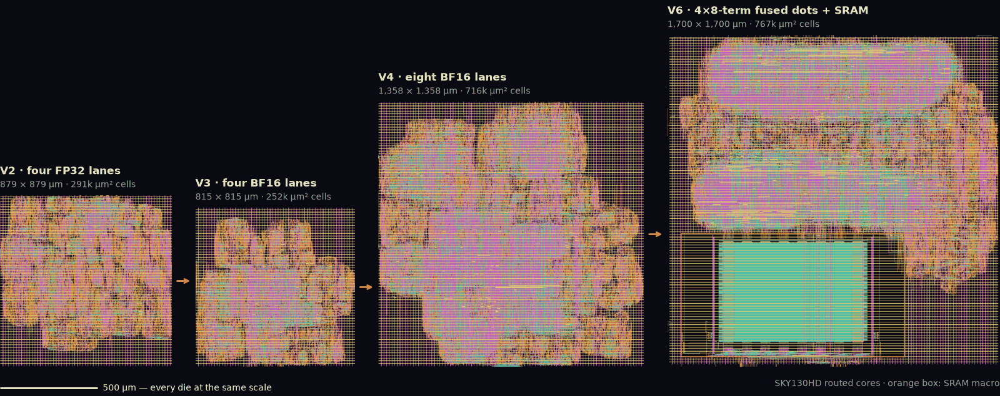

# OpenROAD Chip Lab

BF16 and MXFP8 training-accelerator tiles in Verilog, carried from RTL through bit-exact verification to routed SKY130HD layout with OpenROAD, plus an ASAP7 study of which number format a training MAC should use.

| Tile | MACs/clock | 32³ GEMM, clocks | Verification (RTL and Yosys netlist) | SKY130HD layout at 25 ns |
| --- | ---: | ---: | --- | --- |
| `training_tile_v4` (default) | 8 BF16 | 4,480 | 1,833 functional/training jobs each, bit-compared with FP32 `std::fma` | 716,253 µm² standard cells; setup +7.49368 ns, hold +0.33452 ns; zero routing, antenna and electrical violations |
| `training_tile_v6` | 32 BF16 | 2,181 | 467 GEMMs each | [V6 results](docs/training-v6-results.md) |
| `training_tile_v7` | 64 MXFP8 | 1,616 | 181 GEMMs each; the study's training run on the tile matches the C++ model bit for bit | 974,138 µm² standard cells; setup +5.03 ns, hold +0.26 ns; 1.76× V6's peak MACs/clock/mm² ([V7 results](docs/v7-results.md)) |

At ASAP7 (predictive 7 nm), against a BF16 8-term dot product, an MXFP6 E2M3 32-term block dot product gives 4.0× the throughput per mm² and 3.4× the MACs per joule and trains within 1% of FP32 (+0.64%); MXFP8 gives 1.9× and 2.3× with more margin (+0.37%). MXFP4 and NVFP4 are denser but miss the gate. See [numerics results](docs/numerics-results.md).



*V2 to V6 routed SKY130HD cores at one scale ([layouts](docs/physical-flow.md#layouts)).*

## Why it matters

Training accelerators win or lose on MAC arithmetic, operand reuse and memory bandwidth. This repo measures each: a tile that routes and meets timing, a cycle model matching RTL clock for clock, and a format study weighing area and energy against accuracy.

## Quick start

Simulation needs Verilator, Icarus Verilog, Yosys, Python 3 and a C++17 compiler. Layout also needs Bazelisk and KLayout ([setup](docs/setup.md)).

```sh
make sim                   # 8-bit MAC warm-up core
make sim-training-v4       # V4 tile: functional, training and timed jobs
make sim-training-v4-netlist
make sim-training-v6       # V6 tile: 467 GEMMs
make model-check           # cycle model must match every RTL BENCH line
make layout-training-v4    # SKY130HD RTL-to-GDS; first run builds OpenROAD
```

## Repository layout

| Path | Contents |
| --- | --- |
| `rtl/` | V4 and V6 tiles, FMA and dot-product units, MX and INT8 units, MAC8 |
| `rtl/ppa/` | Registered harnesses for the ASAP7 numerics study |
| `tb/` | Verilator testbenches and bit-exact C++ reference models |
| `model/` | Cycle-level V4/V6 performance model |
| `tools/` | Power, layout and figure scripts; numerics emulation; ORFS Bazel rules |
| `bin/` | `layout` and `ppa` flow drivers with pass/fail gates |
| `third_party/hardfloat/` | Berkeley HardFloat, unmodified and hash-checked |

## Results and verification

| Topic | Design | Interface | Results |
| --- | --- | --- | --- |
| Eight-lane BF16 tile (V4) | [design](docs/training-v4.md) | [interface](docs/training-v4-interface.md) | [results](docs/training-v4-results.md) |
| Fused dot-product tile (V6) | [design](docs/training-v6.md) | [interface](docs/training-v6-interface.md) | [results](docs/training-v6-results.md) |
| Numerics study at ASAP7 | [method](docs/numerics-study.md) | — | [results](docs/numerics-results.md) |
| Cycle-level performance model | [model](docs/tile-perf-model.md) | — | lane, buffer and port sweeps |
| SKY130HD physical flow | [flow](docs/physical-flow.md) | [MAC8](docs/mac8.md) | [layouts](docs/physical-flow.md#layouts) |

A guided [V4 walkthrough](docs/v4-hands-on.md) and a [learning path](docs/learning-path.md) cover the fundamentals.

## Limitations

- Layouts are routed cores, not chips: no pad frame, ESD, foundry DRC/LVS or timing signoff.
- ASAP7 is predictive: its figures rank design points, never foundry numbers.
- Power comes from zero-delay simulation, so glitch power is missing; the SKY130 SRAM macro's Liberty model charges a flat energy per clock.
- The training check is one dense layer (V4) and a 64-unit MLP (numerics study), not transformer scale.

## Related projects

- [bf16-fpga](https://github.com/NicholasUnruh/bf16-fpga): the unmodified V4 tile training a dense layer on a DE1-SoC FPGA.
- [cuda-gemm](https://github.com/NicholasUnruh/cuda-gemm): the same GEMM on a GPU, from a naive kernel to tensor cores.
- Portfolio: https://genwealth.world

## License

MIT. See [LICENSE](LICENSE). Berkeley HardFloat keeps its BSD license ([third_party/hardfloat](third_party/hardfloat/README.md)).
