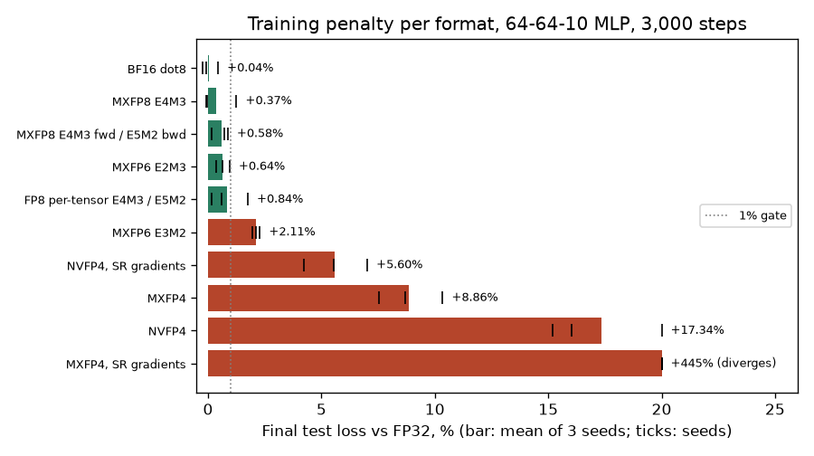

# Which microscaled formats still train: MXFP6, MXFP4 and NVFP4 against MXFP8

## Question

V7 uses MXFP8 E4M3 because the numerics study only compared it with BF16, per-tensor FP8 and MXFP4. Smaller formats exist: OCP MXFP6 (E3M2 and E2M3), MXFP4 (E2M1), NVIDIA's NVFP4, and E5M2 for gradients. If one of them trains within the 1% gate, it would be cheaper silicon and V7 should use it. Which ones pass, and what makes the difference?

## Concept

Every format here stores small floating-point elements and a shared scale per block. The element spends its bits on exponent (range inside the block) and mantissa (precision). The block scale already moves each block to the right binade, so the element's exponent only has to cover the spread *within* 32 neighbouring values. That suggests mantissa bits matter much more than exponent bits once a block scale exists.

NVFP4 differs from MXFP4 in two ways. Its blocks are 16 elements instead of 32. Its block scale is an E4M3 number rather than a power of two, so a block's largest element lands exactly at the top of the E2M1 range (6) instead of anywhere in [4, 8). A per-tensor FP32 scale moves the whole tensor into E4M3's range first.

Round-to-nearest biases small gradients toward zero, because values below half an LSB vanish. Stochastic rounding (SR) rounds up with probability equal to the discarded fraction, which is unbiased on average but adds noise. The NVFP4 paper uses it on gradients only.

## What I tried

I extended the study's bit-exact C++ references (`tb/mx_model.h`, `tools/numerics/datapaths.h`, documented in [numerics-reference.md](../numerics-reference.md)). The work had four parts:

- E5M2, E3M2 and E2M3 elements in `mx_dot32`.
- A 32-element NVFP4 unit, `nvfp4_dot32`: two 16-element blocks with E4M3 scales, summed exactly and rounded once.
- The NVFP4 quantizer from the paper's Appendix B.
- Stochastic rounding with an explicit 16-bit random input.

The RTL unit `rtl/mx_dot32_fp32.v` gained the same types (`ELEM` 2 to 5). It matches the references on 2.1 million vectors per type.

The training experiment is the study's: a 64-64-10 MLP learning a fixed teacher, with every GEMM emulated bit-exactly through the format. It runs 3,000 steps per seed, 3 seeds, and is scored by final test loss against FP32 (`make numerics`). SR recipes round the gradient operand of the backward GEMMs stochastically and the weights and activations to nearest.

Before trusting the SR results, I checked the quantizer for bias. Over 200,000 draws per value, E2M1 SR means match the input to 3 to 4 digits (0.1 → 0.0999, 4.7 → 4.6976; `tools/numerics/sr_check.cpp`, `results/numerics/sr_check.txt`).

## Output

GEMM error, median of |y − y₆₄| / Σ|aᵢbᵢ| over 2,000 dot products of length 4,096 (`results/numerics/gemm_error.txt`):

| Format | Element | Gaussian | Laplace | Outliers | Row-scaled |
| --- | --- | ---: | ---: | ---: | ---: |
| MXFP8 | E4M3 | 6.9e-4 | 9.8e-4 | 3.8e-3 | 7.1e-4 |
| MXFP6 | E2M3 | 6.7e-4 | 9.3e-4 | 4.0e-3 | 6.5e-4 |
| MXFP8 | E5M2 | 1.2e-3 | 1.6e-3 | 6.3e-3 | 1.3e-3 |
| MXFP6 | E3M2 | 1.2e-3 | 1.7e-3 | 6.4e-3 | 1.3e-3 |
| NVFP4 | E2M1 | 2.3e-3 | 2.8e-3 | 9.0e-3 | 2.2e-3 |
| MXFP4 | E2M1 | 2.6e-3 | 3.8e-3 | 1.4e-2 | 2.6e-3 |

Training, final test loss, mean of 3 seeds (`results/numerics/train_*.txt`):

```
fp32                  0.8145
mxfp8 (E4M3)          0.8176  +0.37%
mxfp8 E4M3 / E5M2 bwd 0.8193  +0.58%
mxfp6_e2m3            0.8198  +0.64%
fp8_tensor            0.8214  +0.84%
mxfp6_e3m2            0.8317  +2.11%
nvfp4_sr              0.8601  +5.60%
mxfp4                 0.8867  +8.86%
nvfp4                 0.9558  +17.34%
mxfp4_sr              4.4396  diverges (seed 0: test loss 1.06 at step 300, 3.71 at 3,000)
```



What to notice: the formats that pass are exactly those with three mantissa bits (E4M3, E2M3) plus E5M2 used only for gradients. MXFP6 E2M3 passes with six bits per element, and MXFP6 E3M2 fails with the same six bits split the other way. The 4-bit formats all fail, and SR helps NVFP4 but destroys MXFP4.

## Result

- **Mantissa bits set the error once a block scale exists.** E2M3 matches E4M3, and E3M2 matches E5M2, to within 10% on every distribution. The extra exponent bits buy range the block scale already provides.
- **MXFP6 E2M3 passes the gate (+0.64%).** It is the only sub-8-bit format that does, so it is the low-bit candidate for silicon. MXFP6 E3M2 fails (+2.1%).
- **All 4-bit formats fail.** NVFP4 has lower GEMM error than MXFP4 but trains worse with round-to-nearest (+17% against +9%). With SR on gradients, NVFP4 improves to +5.6%, the best 4-bit result. MXFP4 with SR diverges in all three seeds even though the rounding is unbiased. A likely cause, not yet measured, is variance: with power-of-two scales and 32-element blocks, small gradient elements fall where E2M1's spacing is coarse, so each SR draw moves them by a large fraction of their value. In four 64-term test dot products with a heavy-tailed SR operand, the result's standard deviation over 20,000 draws was 2.7 to 5.9, on exact values from 1 to 41 (`results/numerics/sr_check.txt`). Neither 4-bit result is tuned (learning rate, Hadamard transforms and BF16 layers in the NVFP4 recipe are not modelled), so this says the plain recipes fail here, not that FP4 training cannot work.
- This is one small network. The gate and the ranking need the larger training runs before a format choice is final.

## Next

Route the four new units (E5M2, E3M2, E2M3, NVFP4) in ASAP7 with VCD power, like the original study points, and rank throughput per mm² and per joule among the formats that pass. If MXFP6 E2M3 beats MXFP8 E4M3 in silicon, V7's element type should change.
