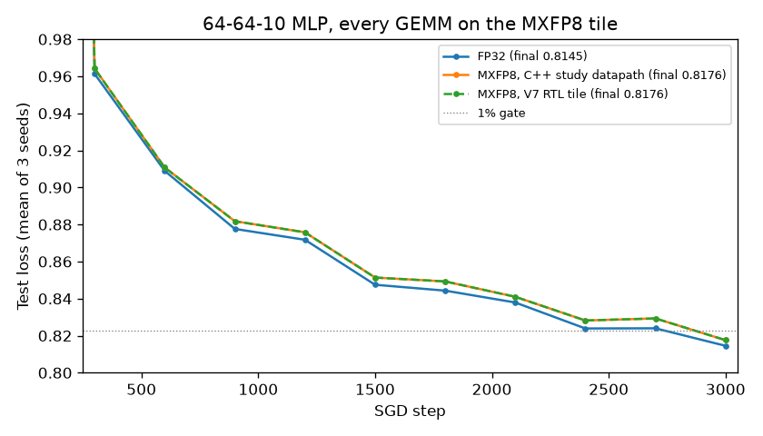

# Building the MXFP8 tile the numerics study picked

## Question

The ASAP7 numerics study ranked an MXFP8 32-term block dot product first: 2.17× the throughput per mm² of the BF16 dot8 unit and 2.33× the MACs per joule, while training within 1% of FP32. That ranking is about one isolated unit. Does the unit still deliver once it sits inside a real tile, with a scratchpad, a loader and a host protocol, and does training on that tile still pass the gate?

## Concept

A floating-point number spends bits on an exponent (range) and a mantissa (precision). FP8 E4M3 has 4 exponent bits and 3 mantissa bits, so on its own it covers only about 2⁻⁹ to 448. Microscaling (OCP MX) adds one shared power-of-two scale per block of 32 elements, stored as an 8-bit exponent (E8M0). Each block is scaled so its largest element lands near the top of E4M3's range, and the scale carries the rest. Range now comes from the scale and precision from the element, so 8-bit elements can represent tensors whose values span many decades.

In hardware, a block dot product multiplies 32 element pairs exactly (a 4-bit × 4-bit significand product), adds them exactly in a wide fixed-point sum, then applies the two block scales as one exponent add and rounds once to FP32. There is no per-element alignment shifter as in a BF16 adder tree, which is where the area and energy savings come from.

The tile question is about bandwidth. V6 reads one 128-bit scratchpad row per clock, eight BF16 elements. The same row holds sixteen E4M3 elements, so the same port can feed twice the MACs, but MX blocks run along K: one job has to reduce a whole 32-element block, and the scales take two extra reads per job.

## What I tried

`rtl/training_tile_v7.v` keeps V6's 4 KB SRAM scratchpad, loader, double-buffered operand registers and two C banks, and replaces the four BF16 dot8 units with two `mx_dot32_fp32` units (E4M3 elements, FP32 accumulate). A job is an 8×8 output tile × one 32-element K block: 2 scale rows, 16 B rows and 16 A rows, 34 reads, then 32 compute clocks. Both A and B are stored K-contiguous (C = A·Bᵀ), because MX quantizes along K and a transpose would split blocks across rows.

Verification follows V6:

- a bit-exact C++ reference (`tb/mx_tile.h`, chaining the study's `mx_dot32` from +0 once per K block);
- a Verilator GEMM regression of 181 GEMMs, run on the RTL and on the Yosys netlist;
- seven RTL mutations, each of which the regression must catch (`tools/v7_mutations.sh`);
- the study's training run with every GEMM executed by the Verilated tile and compared bit for bit with the study's C++ datapath (`tb/mx_tile_train.cpp`).

One mutation set the job start threshold one load earlier (index 19 instead of 20). The regression caught it, which shows the start index is exact rather than conservative.

## Output

```
PASS: 88 GEMM shapes (1-4 tiles of M and N, 1-4 K blocks, all that fit), exact and scaled; 64 raw E4M3/E8M0 encoding GEMMs; wraparound bases; stalled and delayed drains
PASS: quiet E4M3 NaN and NaN scale; overflow and underflow flags combine across jobs and clear on start
PASS: busy start rejection, 10 reset aborts and restarts, scratchpad writes overlapped with computation
BENCH design=training_tile_v7 mode=gemm32_scratchpad cycles=1616 bytes=6208 flops=65536 target_mflops=1622.18
BENCH design=training_tile_v7 mode=gemm16x32_pipelined matrices=8 cycles=2824 bytes=16640 flops=131072 target_mflops=1856.54
BENCH design=training_tile_v7 mode=gemm16x8x128_compute jobs=8 cycles=366 macs=16384
PASS: training_tile_v7 gemms=181 jobs=1710
```

Training (final test loss per seed; the first three lines are FP32, the next three the C++ MXFP8 datapath, the last three the RTL; `results/v7/`):

```
kind recipe seed step train_loss test_loss test_accuracy
final fp32 0 3000 0.870305 0.813015 0.702148
final fp32 1 3000 0.851784 0.812255 0.692871
final fp32 2 3000 0.70692 0.818297 0.69873
final mxfp8 0 3000 0.876497 0.813844 0.697266
final mxfp8 1 3000 0.880367 0.814139 0.699219
final mxfp8 2 3000 0.714556 0.824747 0.69043
final mxfp8 0 3000 0.876497 0.813844 0.697266
final mxfp8 1 3000 0.880367 0.814139 0.699219
final mxfp8 2 3000 0.714556 0.824747 0.69043
PASS: training_tile_v7 ran 188448 tile GEMMs in 306971137 clocks, all bit-exact against the study's MXFP8 datapath
```



What to notice: the V7 RTL curve lies exactly on the C++ MXFP8 curve, because every tile GEMM matched the study datapath bit for bit. Both end below the 1% gate line, a small fixed gap above FP32.

## Result

The tile works and keeps the study's accuracy. V7 sustains 60.2 MACs per clock (64 peak, the two scale reads cost 6%) against V6's 32, from the same 128-bit read port. A 32³ GEMM takes 1,616 clocks against V6's 2,181. Both tiles are bound by the host link at that size, and V7 wins because its operands are half the bytes. Training on the RTL ran 188,448 tile GEMMs, all bit-exact, and finished at 0.8176 mean test loss, +0.38% against FP32's 0.8145, inside the 1% gate.

Silicon cost is still the study's ASAP7 estimate for one unit. The tile's own area, timing and energy per MAC are not measured yet.

## Next

Lay out V7 next to V6 in SKY130 with the same clock and flow, and add VCD-annotated power for V4, V6 and V7, to see whether the ASAP7 unit ranking survives a full tile with an SRAM macro. In parallel, the format comparison extends the same unit to MXFP6, MXFP4 and NVFP4, to check that MXFP8 is still the right element type.
