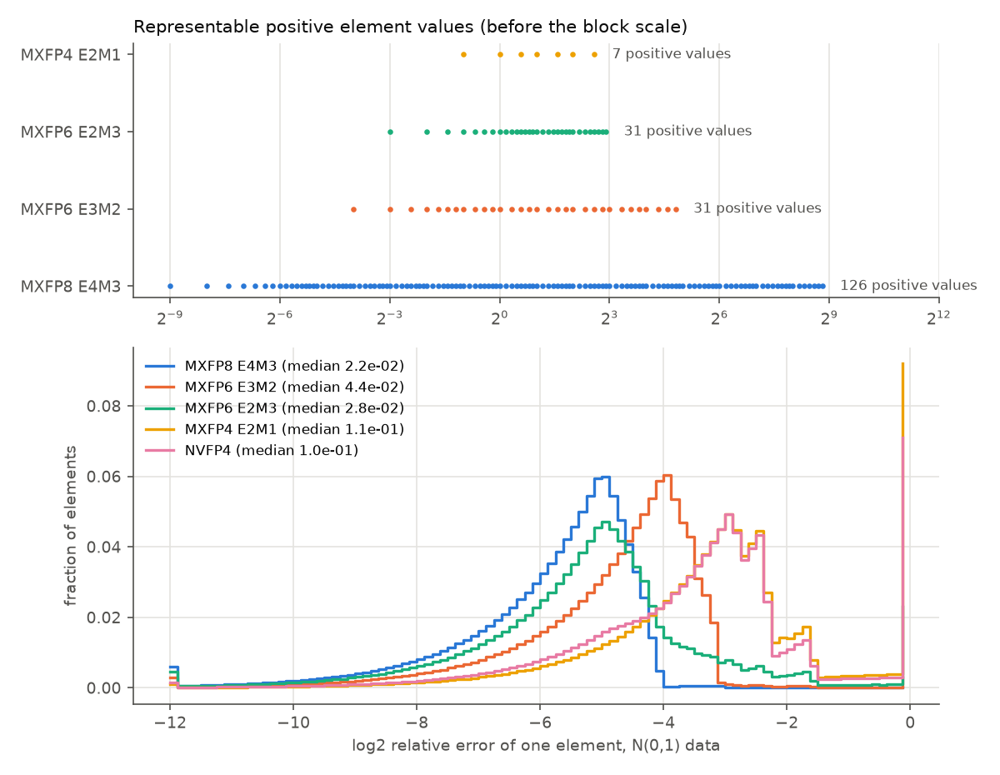

# Emulating microscaled GEMMs bit-exactly in PyTorch

## Question

Can a PyTorch training run use exactly the arithmetic of the chip lab's block dot-product units, bit for bit, so that any accuracy loss measured in training is the format's and not the emulator's?

> **Emulation scope (applies to every training-* result).** Only the GEMMs of the transformer-block Linear layers (attention QKV and output projections, both MLP layers) run in the low-precision format, in the forward pass and both backward GEMMs. The attention products QKᵀ and AV, the embeddings and the tied LM head stay in BF16, following the NVFP4 training recipe of arXiv 2509.25149. Results are therefore *not* full-network low-precision training.

## Concept

**Small floating-point formats.** An element format ExMy has a sign, x exponent bits and y mantissa bits. The stored exponent field e is offset by a *bias* of 2^(x−1) − 1, so a normal value is (−1)^s · 1.m · 2^(e − bias). For E4M3 the bias is 7: field 1 is 2^−6 and field 15 is 2^8. E4M3 gives up infinity to reach 448 = 1.75 · 2^8. Field 0 holds subnormals, 0.m · 2^(1 − bias), which reach down to 2^−9 for E4M3.

| Element | Bias | Largest | Smallest subnormal | Positive values |
| --- | ---: | ---: | ---: | ---: |
| E4M3 (MXFP8) | 7 | 448 | 2^−9 | 126 |
| E3M2 (MXFP6) | 3 | 28 | 2^−4 | 31 |
| E2M3 (MXFP6) | 1 | 7.5 | 2^−3 | 31 |
| E2M1 (MXFP4, NVFP4) | 1 | 6 | 2^−1 | 7 |

**Block scaling.** Seven positive values cannot cover a tensor's range, but they can cover one *block* of 32 neighbouring values, because neighbouring activations and weights have similar magnitude. OCP MX v1.0 stores one power-of-two scale per 32 elements, an E8M0 byte, chosen so the block's largest magnitude lands in the element's top binade:

    shared = floor(log2(max |x| in block)) − emax_element      x ≈ 2^shared · element

NVFP4 (arXiv 2509.25149) uses blocks of 16 with an E4M3 scale, which is not restricted to powers of two, plus one FP32 scale per tensor.

**What the hardware computes.** The chip lab's block unit multiplies two blocks, sums the 32 products *exactly*, scales the sum by 2^(sa+sb), adds the FP32 accumulator, and rounds once to nearest-even FP32. A K-long dot product chains K/32 of these from +0.

```
 A block (32 x E4M3) ──┐                      2^(sa+sb)
                       ├─ 32 exact products ─ Σ exact ─ × ─┐
 B block (32 x E4M3) ──┘                                   ├─ + ─ round once ─ acc
                                         acc (FP32) ───────┘       (RNE, FP32)
```

**Why this is hard to emulate.** Every element is an integer on a fixed-point grid. E4M3's grid step is 2^−9, so each element is an integer of at most 18 bits, |q| ≤ 448 · 2^9. A 32-term block sum then needs up to 41 bits. FP32 matmul keeps only 24, and the GPU's FP8 tensor cores do not document how they round partial sums. A plain `torch.matmul` therefore cannot reproduce the unit.

**Round to odd.** The accumulator add, acc + S, must be rounded once. Computing it in float64 and then casting to FP32 rounds twice and can land on the wrong side of a tie. Rounding the float64 sum *to odd* (when inexact, keep the neighbour whose last bit is 1) and then to nearest FP32 is provably the same as one correct rounding (Boldo and Melquiond, IEEE Trans. Computers, 2008). The odd last bit acts as a sticky bit.

## What I tried

1. **Quantizer** (`tools/numerics/training/mx.py`): the study's C++ `to_small` and the OCP shared-exponent rule, written with exact operations only. `frexp` gives floor(log2), the scaling is by powers of two, and `torch.round` rounds half to even. Elements are kept as grid integers.
2. **Reference GEMM** (`mx.gemm_reference`): per block, an int64 matrix product of grid integers is exact. Each block is then scaled and added to the accumulator with the round-to-odd float64 add, then cast to FP32.
3. **NVFP4 quantizer**: the paper's Appendix B equations in FP32 arithmetic, as production NVFP4 software does: encode = 2688 / amax_tensor, block scale = E4M3(amax_block / 6 · encode), element = E2M1(x · encode / scale). The C++ side performs the same float operations in the same order.
4. **Randomized cross-check** (`xcheck.py` + `xcheck.cpp`). The same FP32 matrices go through the C++ references: `to_small`, `mx_chain` (which uses `mx_dot32` from `tb/mx_model.h`), and the 640-bit exact-sum oracle `dot8::exact_round`. They also go through the Python path. Seven data distributions stress the corners: Gaussian, Laplace, 1% outliers ×1000, rows scaled over 2^±40, elements over 2^±30 (saturation and subnormals), short integers (exact ties), and 90% zeros. Dequantized elements are compared by value and GEMM outputs by raw bits. For E4M3 and E2M1 the C++ program also requires the generic oracle to equal the study's own `mx_chain`.

The first run failed in two instructive ways:

- **Signed zeros.** Hundreds of element mismatches were all −0 against +0: the C++ codes carry a sign bit on zero, and the integer grid cannot. A zero element adds nothing to an exact sum either way, so elements are now compared by value; GEMM outputs are still compared bit for bit.
- **E5M2 overflowed int64.** E5M2 spans 32 binades, so its grid integers need 33 bits and a 32-term sum needs up to 69. The E5M2 quantizer is exact, but its block GEMM is not emulated. The reference now refuses it explicitly. No training recipe here uses MX E5M2.



*Top: every positive value each element format can hold; MXFP4 has seven. Bottom: per-element relative error on N(0, 1) data. Note the large step from FP6 to FP4, and the spike at 1.0: elements flushed to zero.*

## Output

`uv run --extra cpu python xcheck.py --cases 40` (CPU reference against C++), saved in `docs/journal/data/training-xcheck-cpu.txt`:

```
mxfp8          1819200 elements   153054 outputs checked
mxfp8_e5m2     1900800 elements        0 outputs checked
mxfp6_e3m2     1959392 elements   160717 outputs checked
mxfp6_e2m3     1868032 elements   140202 outputs checked
mxfp4          1797216 elements   153154 outputs checked
nvfp4          1957760 elements   160019 outputs checked
PASS
```

## Result

The PyTorch quantizers and reference GEMM match the C++ references exactly. That is 11.3M quantized elements and 767k GEMM outputs over 1,680 random cases, with zero bit differences, for MXFP8, MXFP6 (E3M2 and E2M3), MXFP4 and NVFP4. E5M2 is matched at the quantizer only. The NVFP4 dot unit and the stochastic-rounding quantizers are not yet in the C++ references: the NVFP4 check runs against the same exact-sum oracle with the provisional unit definition (16-term exact sum, exact E4M3 × E4M3 scale product, one FP32 rounding per block, tensor scale applied once at the output). It will be re-run when the unit lands.

## Next

The reference is exact but runs on the CPU at a few GFLOP/s. GPT-2 training needs the same arithmetic on the GPU at tensor-core speed, without giving up exactness.
