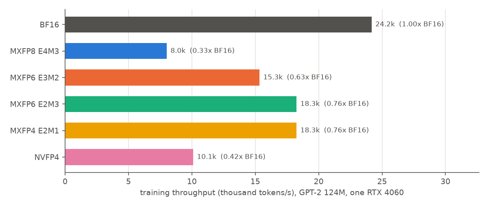

# Exact block GEMMs on int8 tensor cores

## Question

Can the bit-exact emulation run fast enough on one RTX 4060 (8 GB) to train GPT-2 small (124M parameters) in every format within a few days?

> **Emulation scope.** The emulated GEMMs are those of the transformer-block Linear layers (forward and both backward GEMMs). Attention QKᵀ/AV, the embeddings and the tied LM head stay in BF16 (arXiv 2509.25149). NVFP4 numbers are provisional until the NVFP4 dot unit lands in the C++ references and the cross-check is re-run against it.

## Concept

**Fixed-point view of a block dot product.** Every element of a block is an integer q on its format's grid, so the exact block sum is an *integer* dot product, Σ qa·qb. This is the aligned integer sum the hardware unit forms in its adder tree. Integer tensor cores compute int8 × int8 → int32 products exactly, and a 32-term sum of them stays exact.

**Splitting wide integers into int8 pieces.** E2M1 grid integers fit in 4 bits and E2M3 in 6, so one int8 matmul per block is exact. Wider grids are split into 6-bit pieces, q = Σ pᵢ · 64^i, with the top piece signed:

```
E4M3 grid integer (19 bits incl. sign):   q = p2·4096 + p1·64 + p0
                                               signed    0..63   0..63
Σ qa·qb = Σ_k 64^k · ( Σ_{i+j=k} pa_i · pb_j )      5 weight classes, 9 int8 matmuls
```

E3M2 needs two pieces (4 matmuls) and E4M3 three (9 matmuls). Each weight class is summed in int32. Integer carries then normalize the 41-bit E4M3 sum into hi · 2^18 + lo with 0 ≤ lo < 2^18 and |hi| < 2^23, so both halves are exact FP32 numbers.

**One rounding of a three-term sum.** For E4M3 the accumulator update is acc + hi·2^18·f + lo·f, where f is the product of the block scales. Each term is exact in FP32, but their sum must be rounded only once. The Boldo–Melquiond algorithm does that with FP32 operations only: two error-free TwoSums, one addition rounded to odd (bit manipulation on the result), and a final addition rounded to nearest. For FP4 and FP6 the block sum is below 2^24, so a single FP32 add already rounds exactly once.

**Exactness guard.** Scaling by the block scales is exact only while the smallest product LSB, 2^(sa+sb+2·grid), stays at or above FP32's smallest subnormal 2^−149. The kernel counts violations on the GPU and the trainer checks the count after each step. A violation stops the run instead of silently changing the arithmetic.

## What I tried

1. **First kernel** (Triton): `mx.quantize` in plain PyTorch, then int8 piece matmuls with int64 combining. It was bit-exact against the C++ references on the first try, but 7–40× slower than cuBLAS BF16: 0.7–4.2 effective TFLOP/s. For FP4 and FP6, more than half of the time went to the quantizer, which launched ~20 elementwise kernels per tensor.
2. **Fused quantizer** (`kernel.pack`): one Triton pass per tensor computes the block amax, shared exponent, rounding and int8 pieces. It reads any strides, so the transposed operands of the backward GEMMs cost no copies. FP4/FP6 rose to 15–22 TFLOP/s.
3. **Removing int64 from MXFP8**: int64 arithmetic and int64↔float conversions are slow on this GPU. The int32 carry normalization above replaced them and doubled MXFP8 to ~4.5 TFLOP/s.
4. **NVFP4 in FP32**: the first NVFP4 quantizer divided in float64, which runs at 1/64 rate here. Switching to FP32 with IEEE-rounded division (`div_rn`; Triton's `/` is approximate) cut it about 2.5×. The C++ reference performs the same FP32 operations, so the definition changed in both places at once and the cross-check still passes.
5. **End-to-end training throughput** at 64 sequences × 1,024 tokens per optimizer step. The first measurement, with 8 sequences per forward pass, gave BF16 11.7k tokens/s and every emulated format 4–6k. The profiler then showed the BF16 LM-head GEMM taking 360 ms, about 20× too long. Measured peak memory (BF16, MXFP4) is 4.0–4.3 GB at 2 sequences per pass, 5.7–6.4 GB at 4 and 9.2–10.8 GB at 8, more than the card's 8 GB. The Windows display driver does not fail with out-of-memory; it pages GPU memory to system RAM, so the run was silently slow. With 4 sequences per pass (and 16 accumulation steps), BF16 doubled to 24.2k tokens/s (12.2k at 8 sequences in the same probe).

## Output

Training throughput per format (`train.py --micro 4`, mean of the steps after the first, which includes compilation and autotuning; `docs/journal/data/training-throughput.json`):



*Training speed per format on one RTX 4060. The emulated formats all run bit-exact; the gaps are the cost of exactness (MXFP8 needs 9 int8 matmuls per block), not the cost of the formats in hardware.*

GEMM microbenchmark at GPT-2 shapes, T = 8,192 tokens (`bench.py`; `docs/journal/data/training-bench.txt`):

```
format       gemm       quant ms   gemm ms  TFLOP/s
bf16         qkv            0.00      0.99    29.41
fp32         qkv            0.00      3.29     8.81
mxfp8        qkv            0.25      6.50     4.29
mxfp6_e3m2   qkv            0.22      1.52    16.69
mxfp6_e2m3   qkv            0.19      1.10    22.49
mxfp4        qkv            0.18      1.10    22.77
nvfp4        qkv            0.84      1.90    10.57
bf16         proj           0.00      0.32    30.48
fp32         proj           0.00      1.12     8.65
mxfp8        proj           0.21      1.78     4.84
mxfp6_e3m2   proj           0.19      0.63    11.87
mxfp6_e2m3   proj           0.16      0.45    15.79
mxfp4        proj           0.15      0.45    16.05
nvfp4        proj           0.79      0.65     6.72
bf16         fc             0.00      1.34    28.86
fp32         fc             0.00      4.82     8.02
mxfp8        fc             0.27      8.17     4.58
mxfp6_e3m2   fc             0.24      2.23    15.71
mxfp6_e2m3   fc             0.20      1.56    21.96
mxfp4        fc             0.19      1.51    22.72
nvfp4        fc             0.86      2.53    11.39
bf16         mlp_proj       0.00      1.21    32.06
fp32         mlp_proj       0.00      4.60     8.40
mxfp8        mlp_proj       0.86      7.57     4.59
mxfp6_e3m2   mlp_proj       0.75      3.60     8.89
mxfp6_e2m3   mlp_proj       0.61      1.93    15.25
mxfp4        mlp_proj       0.58      1.93    15.38
nvfp4        mlp_proj       2.43      2.33     8.11
```

## Result

Exact emulation costs 0.76× BF16's training speed for MXFP4 and MXFP6 E2M3, 0.63× for E3M2, 0.42× for NVFP4 and 0.33× for MXFP8. These ratios measure the emulator, not the formats: a native MXFP8 tensor core would be faster than BF16. The GPU kernel stays bit-exact against the C++ references: over 1,400 random cases (every format except E5M2), the GPU grid integers, block factors and 767k GEMM outputs all match with zero bit differences (`docs/journal/data/training-xcheck-gpu.txt`).

Sizing: training every format on the same 300M tokens (4,577 steps of 65,536 tokens) takes about 3.5 h for BF16, 10.4 h for MXFP8, 4.6–5.4 h for each MXFP6 and MXFP4 run, and 8.2 h for NVFP4. That is about 37 GPU-hours for the six formats, leaving room inside three days for pauses and stochastic-rounding variants. 300M tokens is about 2.4 tokens per parameter, far below the ~20 of a compute-optimal run, so the comparison is between formats at equal budget, not a converged GPT-2.

## Next

Start the runs: BF16, then MXFP8, MXFP4, NVFP4, MXFP6 E2M3 and MXFP6 E3M2, with the same seed, data order and hyperparameters. The runs are resumable and yield the GPU to interactive use.
