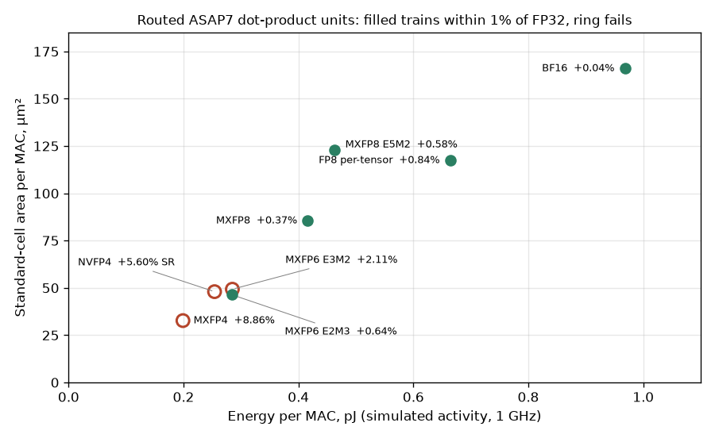

# What each microscaled format costs in silicon

## Question

The accuracy study left four formats inside the 1% training gate: MXFP8 E4M3, MXFP8 with E5M2 gradients, MXFP6 E2M3 and per-tensor FP8. It also left three cheaper-looking formats outside it: MXFP6 E3M2, MXFP4 and NVFP4. What does each one cost as a routed dot-product unit, and is MXFP6 E2M3 cheap enough to beat MXFP8, the format V7 was built in?

## Concept

A block dot product multiplies 32 element pairs, shifts each product to a common exponent, and adds the 32 terms exactly before one FP32 rounding. Two widths set the area:

- **The multiplier** grows with the significand: (mantissa + 1)² bits of partial products per lane.
- **The exact fixed-point sum** must cover every product exponent, so its width grows with 2^exponent bits. That width is `FIXW` in `rtl/mx_dot32_fp32.v`, set by the element type alone: E4M3 needs 36 bits per product, E5M2 66, E3M2 18 and E2M3 12. The 32-term adder tree and the alignment shifters scale with it.

So E5M2 should cost more than E4M3 despite having fewer mantissa bits, and E2M3 should be the cheapest 6-bit format.

NVFP4 adds a cost the OCP formats avoid. Its block scale is an E4M3 number, not a power of two, so each 16-element block sum is multiplied by the product of the two scale significands (8 bits) before the two blocks are aligned and added. An MX scale is only an exponent add.

## What I tried

I added four units to the study's ASAP7 harness set: E5M2, E3M2, E2M3 and NVFP4 (`rtl/ppa/ppa_dot32_*.v`, one parameter each on `mx_dot32_fp32`). All 15 points were routed in one Bazel build with the same flow, utilization and 1 GHz target (`make ppa-all`), so the new units and the old ones come from the same RTL and tools.

Energy comes from simulation, not estimated activity. Each routed netlist runs 2,000 clocks of N(0, 1) operands quantized to its format: MX blocks get a power-of-two scale, NVFP4 blocks an E4M3 scale under a per-tensor FP32 scale (`tools/ppa_activity.py`). The routed outputs must match the Yosys netlist bit for bit, and they do for all 15. OpenSTA then reads the VCD and the extracted parasitics. The tables are printed by `tools/numerics/report.py`, and the per-format rows below are written by `tools/journal/results_json.py`.

## Output

| Unit | Area/MAC µm² | Energy/MAC fJ | fmax MHz | Trains (best recipe) |
| --- | ---: | ---: | ---: | --- |
| BF16 dot8 | 166 | 968 | 928 | yes, +0.04% |
| FP8 E4M3 dot8 (per-tensor) | 117 | 664 | 1006 | yes, +0.84% |
| MXFP8 E5M2 | 123 | 462 | 938 | yes, +0.58% (E5M2 gradients only) |
| MXFP8 E4M3 | 85 | 416 | 905 | yes, +0.37% |
| MXFP6 E3M2 | 49 | 285 | 1047 | no, +2.11% |
| NVFP4 | 48 | 254 | 829 | no, +5.60% with SR |
| MXFP6 E2M3 | 46 | 284 | 1041 | yes, +0.64% |
| MXFP4 | 33 | 199 | 1040 | no, +8.86% |

What to notice: the MXFP6 E2M3 point sits in the cluster of failing low-bit units, near 46 µm² and 0.28 pJ per MAC. It is about half of MXFP8's area per MAC and two thirds of its energy. Every other passing unit is above and to the right of MXFP8.

## Result

- **MXFP6 E2M3 is the cheapest format that trains.** Against the BF16 dot8 it gives 4.0× the throughput per mm² and 3.4× the MACs per joule; MXFP8 E4M3 gives 1.9× and 2.3×. It is cheaper than MXFP8 because both widths shrink: four-bit significands like E4M3, but 12-bit instead of 36-bit fixed-point products.
- **E5M2 costs 44% more area per MAC than E4M3**, as the 66-bit product width predicts. A training chip that keeps E5M2 for gradients pays for it in every lane, or needs a unit that switches.
- **NVFP4 costs about as much as MXFP6.** Its scale multiplier makes it 47% larger per MAC than MXFP4 and the slowest unit (829 MHz). With MXFP6 E2M3 at nearly the same area and inside the gate, NVFP4 has no case on this model.
- **The fmax column is noisy.** Re-routing unchanged BF16 units moved fmax by up to 9% while area and energy stayed within 3%. The previous route's 2.17× throughput per mm² for MXFP8 is 1.90× here for that reason. E2M3's 2.1× lead over MXFP8 is far outside that noise.
- **Decision: V7 stays MXFP8.** The accuracy entry said V7's element type should change if E2M3 won in silicon, and it has. I am keeping V7 as built, for two reasons. First, the SKY130 tile measurement is the test of the original study's pick, so changing the tile now would leave that prediction untested. Second, E2M3's margin (+0.64% on a 64-unit MLP, three seeds) is thinner than MXFP8's and needs the larger training runs before a tile commits to it. E2M3 is the format for the next tile if those runs hold.

## Next

- Route BF16 dot8, MXFP8 and MXFP6 E2M3 units in SKY130HD with the same VCD power method. That tests whether the ASAP7 ranking survives a real PDK, unit for unit.
- Lay out V7 next to V6 in SKY130HD and measure its energy per MAC on the GEMM regression.
