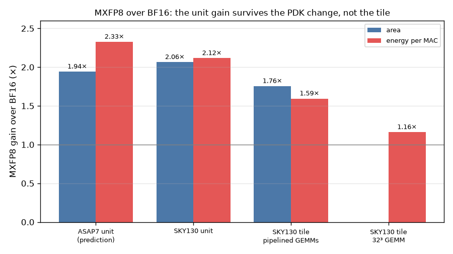

# Does the format study's prediction hold in silicon?

## Question

The ASAP7 study picked MXFP8 over BF16, predicting 1.9× the throughput per mm² and 2.3× the MACs per joule. I built V7 in MXFP8 to test that. Laid out in SKY130HD next to the BF16 V6 tile, with measured power, does the gain survive? And does the study's ranking hold in a real PDK?

## Concept

The prediction came from bare dot-product units on a predictive 7 nm PDK. Two things can break it:

- **The PDK.** Cell libraries differ in how adders, multiplexers and flops trade area for energy. If ASAP7 favours one structure, a unit ranking from ASAP7 can reorder in SKY130.
- **The tile.** A tile adds operand registers, the sequencer, the scratchpad and a clock tree that reaches every flop. If those dominate, the format's saving is diluted, however good the unit is.

Separating the two needs both measurements: the same units in SKY130, and whole tiles in SKY130.

## What I tried

- **Units.** I routed the BF16 dot8, MXFP8 and MXFP6 E2M3 harnesses in SKY130HD at a 10 ns target (`make ppa-sky130`). Power uses the study's method: 2,000 clocks of quantized random operands, routed outputs checked against the Yosys netlist, and OpenSTA reading the VCD and the parasitics.
- **Tiles.** I laid out V7 with V6's flow, clock, macro placement and power grid. Only the die grows, to 1,800 µm.
- **Tile power.** I simulated V4, V6 and V7's routed netlists in Verilator on their own GEMM regression benchmarks, then annotated that activity onto the layout (`tools/tile_power.sh`).

The tile power took three fixes before the numbers meant anything:

- The cell-model generator choked on SKY130's quoted flop state names and ignored asynchronous resets.
- It also modelled scan flops twice, because their `test_cell` group repeats the pins.
- The first VCDs held only net names, so OpenSTA matched 95 top-level pins out of 240,000. The rest fell back to a default activity, which gave V4 a meaningless 1,432 pJ/MAC. Tracing cell pins, including Verilator's hidden underscore-named instances, raised coverage to every pin except the antenna diodes, which are not in the simulated netlist.

The script now fails any run with more than 1% of its logic pins unannotated.

## Output

| MXFP8 gain over BF16 | Area | Energy per MAC |
| --- | ---: | ---: |
| ASAP7 unit (prediction) | 1.94× | 2.33× |
| SKY130HD unit | 2.06× | 2.12× |
| SKY130HD tile, V7 vs V6 | 1.75× peak MACs/clock/mm² | 1.59× pipelined, 1.16× 32³ GEMM |

| Tile power at 40 MHz, mW | V6 pipelined | V7 pipelined |
| --- | ---: | ---: |
| Flops | 22.3 | 27.7 |
| Clock tree | 21.7 | 26.0 |
| Combinational logic | 5.3 | 8.8 |
| SRAM macro | 14.4 | 14.4 |
| Total | 63.6 | 76.9 |

What to notice: the first two pairs of bars are nearly equal, so the PDK change barely moves the result. The energy bar collapses only at the tile, and collapses most on the host-bound 32³ GEMM, where the units sit idle most of the time.

## Result

- **The ranking holds across PDKs.** In SKY130HD the units keep the study's order (BF16, MXFP8, MXFP6 E2M3), and every area and energy ratio agrees with ASAP7 within 11%. The format study is a sound way to choose an element type.
- **The area gain mostly survives into the tile.** V7 doubles V6's peak MACs per clock for 27% more standard-cell area, 1.75× the peak density with the SRAM macro counted. V7's two MXFP8 units are smaller than V6's four BF16 units; the growth is operand registers.
- **The energy gain does not survive.** In V6 and V7, flops and the clock tree draw 70% of the power, and combinational logic 8–12%, every clock whether the units are busy or not. Tile power is nearly constant per clock, so energy per MAC follows utilization: V7 saves 1.59× when it is kept busy and 1.16× on a host-bound GEMM. The study overstated the tile-level energy gain by 1.5–2×.
- **So the prediction is confirmed for ranking and area, refuted for energy.** A format study that scores bare units answers "which format", not "how much energy will the chip save". The second question needs the registers and the clock tree in the model.

## Next

- Clock-gate V7's operand registers and the idle unit pipeline, then remeasure. If the arithmetic's share rises, the tile should move toward the unit-level 2.1×.
- Replace the SRAM macro's flat per-edge energy with an enable-dependent model, so scratchpad energy reflects its use.
- Finish the formal sweep of the MX units (`formal/run.sh`).
