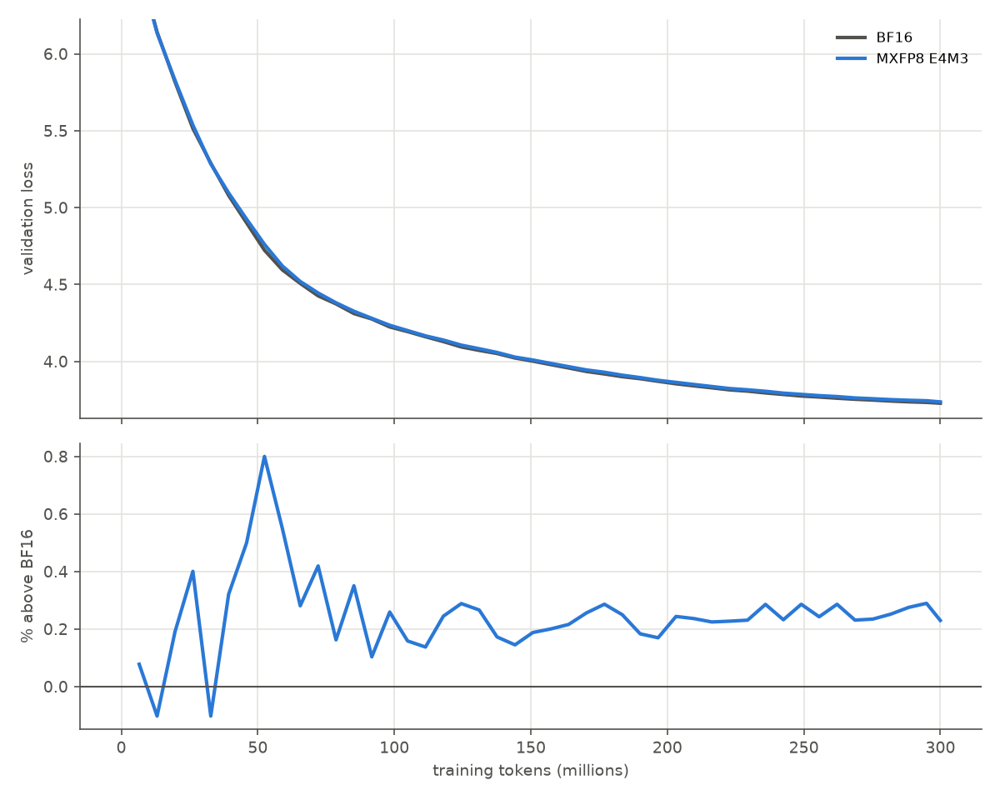

# GPT-2 small in MXFP8: 0.23% above BF16

## Question

How much validation loss does GPT-2 small (124M parameters) lose when its transformer-block GEMMs run in MXFP8 (E4M3 elements, 32-element blocks) with the chip lab's exact arithmetic, against a BF16 run with the same data, seed and hyperparameters?

> **Emulation scope.** Only the transformer-block Linear layers run in MXFP8: attention QKV and output projections and both MLP layers, in the forward pass and in both backward GEMMs (input gradient and weight gradient). Attention QKᵀ/AV, the embeddings, layer norms and the tied LM head stay in BF16, following the NVFP4 pretraining recipe (arXiv 2509.25149). The result is **not** full-network MXFP8 training.

## Concept

**Loss penalty.** Validation loss is the mean cross-entropy, in nats per token, on held-out text. The penalty is the format's final validation loss relative to BF16's at the same step: 100 · (L_format / L_BF16 − 1). Both runs evaluate the same 160 validation batches (655,360 tokens), so sampling noise in the evaluation cancels in the comparison. The evaluation passes go through the same emulated GEMMs as training, so the number includes MXFP8 inference as well as MXFP8 training.

**What the comparison controls.** Both runs see the same 300M tokens in the same order from the same initial weights, with the same learning-rate schedule. The only difference is the arithmetic of the 48 emulated Linear layers. What it does not control is seed-to-seed variation: there is one run per format, so a difference of a few hundredths of a percent would not be distinguishable from noise. The gap's stability over the second half of training is the evidence that it is systematic.

**Budget.** 300M tokens is about 2.4 tokens per parameter, far below the roughly 20 of a compute-optimal run. These are format comparisons at an equal budget, not converged GPT-2 models, and a penalty measured early in training can change as training continues.

## What I tried

GPT-2 124M (12 layers, width 768, context 1,024) on FineWeb-Edu: 4,577 optimizer steps of 65,536 tokens, AdamW at 6 × 10⁻⁴ with cosine decay, on one RTX 4060. Each run was split into hourly chunks with checkpoints, so it survived interruptions:

- **BF16:** ran through four chunks without interruption.
- **MXFP8:** five failures of the exactness guard at steps 126–137, before the float64 fallback existed (`2026-11-12-training-tiny-scales.md`), and five pauses for interactive use of the machine.

Every chunk resumed from its last checkpoint. The per-step logs, deduplicated where a resumed chunk repeated steps, are in `docs/journal/data/training-runs/`. The summary is `docs/journal/data/training-gpt2.json`, written by `tools/numerics/training/summarize.py`.

## Output

*Top: validation loss against training tokens; the two curves overlap. Bottom: MXFP8's loss above BF16's. After the first 100M tokens the gap settles at 0.14–0.29% and stays there.*

| Run | Final validation loss (step 4,577) | Penalty vs BF16 | Median training throughput |
| --- | ---: | ---: | ---: |
| BF16 | 3.7283 | — | 24.0k tokens/s |
| MXFP8 E4M3 | 3.7369 | **+0.23%** | 6.6k tokens/s (emulated) |

*Scope for the penalty: only the transformer-block Linear layers are MXFP8 (forward and both backward GEMMs); the attention products, embeddings and LM head stay in BF16 (arXiv 2509.25149).*

The exact float64 fallback ran in 1,406 of the 4,470 MXFP8 steps after it was added: 6,362 GEMMs out of about 10 million. Steps with a fallback ran at a median 5.4k tokens/s, steps without one at 6.9k. Throughput also varied with use of the machine: the median over 500-step stretches ranged from 5.1k to 7.5k tokens/s. No step ran under the shared-GPU throttle (no `share` events); that mechanism was added during the run.

## Result

MXFP8 costs GPT-2 small 0.23% in final validation loss against BF16, with the block GEMMs computed bit-exactly as the chip lab's MXFP8 unit computes them. Scope: transformer-block Linear layers only; attention products, embeddings and LM head in BF16. That is 0.0086 nats per token at 300M tokens. The gap was noisy early, peaking at 0.8% near 50M tokens, then held between 0.14% and 0.29% from 100M tokens to the end, so it is a steady offset rather than a divergence. For comparison, the chip lab's small-model study measured MXFP8 at 0.37% above FP32. That is a different model, a different baseline and full emulation of a small MLP, so the two numbers agree in size but are not the same measurement.

The emulated MXFP8 run is 3.6× slower than BF16 on this GPU. That is the price of bit-exact emulation (nine int8 matrix products per block, plus the float64 fallback), not a property of MXFP8 hardware.

## Next

MXFP4 is running (it was paused at step 2,169 and is 4.5% above BF16 at matched steps so far). NVFP4 and the two MXFP6 variants follow; each gets the same final-step comparison and a `gpt2_loss_penalty_pct` row in `results.json`. The GPT-2 rows use their own metric name so they do not overwrite the small-model `loss_penalty_pct` rows, which are measured against FP32.
