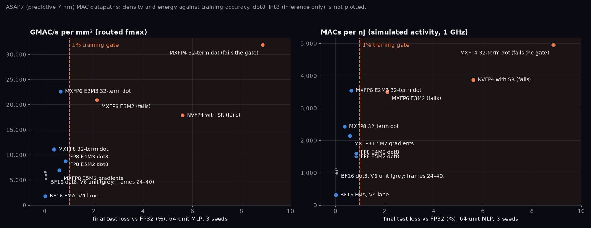
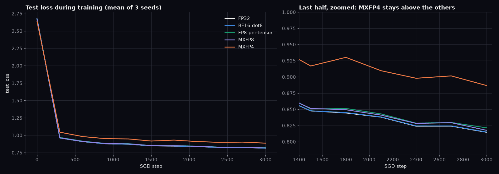

# Numerics study results

Method: [numerics-study.md](numerics-study.md). Verified 2026-11-13 (15 routed points). **ASAP7 is a predictive PDK: every figure below is only a comparison between design points, never a foundry number.**

## Answer

Among datapaths that train within the tolerance, **MXFP6 E2M3 32-term block dot products** give the most throughput per mm² (4.1× the BF16 dot8) and per joule (3.4×), and train at +0.64% test loss. **MXFP8 (E4M3)** is next at 2.0× and 2.3×, with more accuracy margin (+0.37%). Per-tensor FP8 dot8 units follow at about 1.5–1.6×. **MXFP4 is 5.8× denser but fails training** (+8.9%). NVFP4 fails too, even with stochastic rounding (+5.6%). MXFP6 E3M2 costs the same as E2M3 but fails (+2.1%): with a block scale, the extra mantissa bit matters more than exponent range. For BF16, the frame width is a free knob: narrowing the alignment frame from 32 to 24 bits saves 10% area and 6% energy, with no measurable change in error or training. Chained FMAs cost 3.3× the dot8's energy per MAC and give 0.33× its throughput per mm².

**Checked in a real PDK.** BF16 dot8, MXFP8 and MXFP6 E2M3 units routed in SKY130HD keep this order, and their area and energy ratios agree with ASAP7 within 11%. In a full tile, though, MXFP8 saves only 1.2–1.6× energy per MAC over BF16, because flops and the clock tree dominate tile power ([V7 results](v7-results.md#asap7-prediction-vs-sky130hd-measurement)).

## Ranking

Throughput per mm² uses the routed fmax; energy uses simulated activity at 1 GHz. Rank among the points that pass the training gate.

| Rank | Point | Trains | GMAC/s/mm² | × dot8_bf16 | MAC/nJ | × dot8_bf16 |
| ---: | --- | --- | ---: | ---: | ---: | ---: |
| 1 | `dot32_mxfp6_e2m3` | yes | 22,623 | 4.14 | 3,552 | 3.44 |
| 2 | `dot32_mxfp8` | yes | 11,083 | 2.03 | 2,424 | 2.35 |
| 3 | `dot8_e4m3` | yes (FP8 recipe) | 8,843 | 1.62 | 1,518 | 1.47 |
| 4 | `dot8_e5m2` | yes (FP8 recipe) | 8,759 | 1.60 | 1,603 | 1.55 |
| 5 | `dot32_mxfp8_e5m2` | yes (E5M2 gradients) | 6,908 | 1.26 | 2,148 | 2.08 |
| 6 | `dot8_bf16_f24` | yes | 6,565 | 1.20 | 1,099 | 1.06 |
| 7 | `dot8_bf16_f28` | yes | 5,963 | 1.09 | 1,068 | 1.03 |
| 8 | `dot8_bf16` (frame 32, V6 unit) | yes | 5,466 | 1.00 | 1,034 | 1.00 |
| 9 | `dot8_bf16_f36` | yes | 5,395 | 0.99 | 1,005 | 0.97 |
| 10 | `dot8_bf16_f40` | yes | 5,262 | 0.96 | 986 | 0.95 |
| 11 | `fma_bf16` | yes | 1,791 | 0.33 | 313 | 0.30 |
| — | `dot32_mxfp4` | no (with or without SR) | 31,875 | 5.83 | 4,954 | 4.79 |
| — | `dot8_int8` | inference only | 26,973 | 4.93 | 2,985 | 2.89 |
| — | `dot32_mxfp6_e3m2` | no | 20,901 | 3.82 | 3,497 | 3.38 |
| — | `dot32_nvfp4` | no (with or without SR) | 17,888 | 3.27 | 3,874 | 3.75 |



*Each datapath's density and energy against its training loss; only points left of the 1% gate count. MXFP6 E2M3 is the best point that passes; MXFP4 is far denser but lands at +8.9%.*

E4M3 and E5M2 are one recipe (E4M3 forward, E5M2 gradients), so a training chip needs both or a unit that handles both. The `dot32_mxfp8_e5m2` row is the E5M2 unit scored with the MXFP8 recipe that uses E5M2 for gradients; its wider exponent widens the exact fixed-point product from 36 to 66 bits (`FIXW` in `rtl/mx_dot32_fp32.v`), and the unit is 44% larger than E4M3's. The same width explains the MXFP6 pair: E2M3 products need 12 bits, E3M2 products 18.

MXFP6 E2M3 passes the gate with less margin than MXFP8 (+0.64% against +0.37%, three seeds each, seed spread 0.002–0.005), so on this model it is the better silicon choice and the riskier numerics choice.

## Area, fmax and energy

Each unit is routed behind registered inputs in a fixed harness, with a 1 GHz target. Area is standard-cell area, including the harness registers.

| Point | MACs/clk | Area µm² | Area/MAC µm² | fmax MHz | Power at 1 GHz mW | Energy fJ/MAC |
| --- | ---: | ---: | ---: | ---: | ---: | ---: |
| `fma_bf16` | 1 | 583 | 583 | 1044 | 3.19 | 3190 |
| `dot8_bf16` | 8 | 1315 | 164 | 898 | 7.74 | 968 |
| `dot8_bf16_f24` | 8 | 1186 | 148 | 974 | 7.28 | 910 |
| `dot8_bf16_f28` | 8 | 1244 | 156 | 928 | 7.49 | 936 |
| `dot8_bf16_f36` | 8 | 1399 | 175 | 944 | 7.96 | 995 |
| `dot8_bf16_f40` | 8 | 1445 | 181 | 950 | 8.11 | 1014 |
| `dot8_e4m3` | 8 | 935 | 117 | 1034 | 5.27 | 659 |
| `dot8_e5m2` | 8 | 909 | 114 | 995 | 4.99 | 624 |
| `dot32_mxfp8` | 32 | 2731 | 85 | 946 | 13.20 | 412 |
| `dot32_mxfp8_e5m2` | 32 | 3995 | 125 | 862 | 14.90 | 466 |
| `dot32_mxfp6_e3m2` | 32 | 1591 | 50 | 1039 | 9.15 | 286 |
| `dot32_mxfp6_e2m3` | 32 | 1457 | 46 | 1030 | 9.01 | 282 |
| `dot32_mxfp4` | 32 | 1044 | 33 | 1039 | 6.46 | 202 |
| `dot32_nvfp4` | 32 | 1550 | 48 | 866 | 8.26 | 258 |
| `dot8_int8` | 8 | 435 | 54 | 1468 | 2.68 | 335 |

All 15 routes pass hold, slew, capacitance, fanout and router DRC. `fma_bf16` routes with a 25% slew repair margin; without it, one re-route left 88 post-route slew violations. Setup slack is the fmax measurement, not a gate. **fmax is the noisy column.** Re-routing unchanged units has moved fmax by up to 10% (`dot8_bf16_f36`: 854 → 944 MHz; `dot32_mxfp8_e5m2`: 938 → 862 MHz) while area and energy stayed within 3%. MXFP8's throughput per mm² has read 2.17×, 1.90× and 2.03× of BF16 on successive routes for this reason. Throughput ratios are therefore good to about ±10%; area and energy ratios to a few percent. The E2M3-over-MXFP8 gap (2.0× in throughput per mm², 1.5× in energy) is far outside that noise.

NVFP4 costs more than MXFP4 for the same E2M1 elements because each 16-element block sum is multiplied by the product of its two E4M3 scale significands (8 bits) before the two blocks are aligned, where MX applies a power-of-two scale as an exponent add. It is also among the slowest points (866 MHz; only `dot32_mxfp8_e5m2` is slower this route).

**Energy method.** Each routed netlist is simulated with zero-delay cell models generated from the ASAP7 Liberty functions. Stimulus is 2,000 clocks of N(0, 1) operands quantized to the point's format, with N(0, 16) FP32 accumulator inputs. The routed outputs must match the Yosys netlist bit for bit after warm-up, and they do for all 15 points. OpenSTA reads the VCD (100% of pins annotated) and extracted SPEF, then reports power. The earlier probabilistic input-activity method put `fma_bf16` at 17.7 mW, 5.5× the simulated value, because it propagates toggles through the deep arithmetic logic without correlation. Zero-delay simulation leaves out glitch power, so absolute energies are low by an unknown factor; the comparison assumes it is similar across points.

## GEMM error

Median / p99 of |y − y₆₄| / Σ|aᵢbᵢ| over 2,000 dot products per cell. Every BF16 variant matches `bf16_fma` to three digits at every frame width: BF16 input rounding (relative 2⁻⁹) swamps the frame truncation, which even at 24 bits sits 16 bits below the largest term.

| Datapath | Gaussian K=4096 | Laplace K=4096 | Outliers K=4096 | Row-scaled K=4096 |
| --- | ---: | ---: | ---: | ---: |
| `bf16_fma`, `bf16_dot8` (all frames) | 3.6e-5 / 1.4e-4 | 4.7e-5 / 1.9e-4 | 1.9e-4 / 7.8e-4 | 3.9e-5 / 1.5e-4 |
| `e4m3_tensor` | 6.2e-4 / 2.3e-3 | 8.2e-4 / 3.1e-3 | 3.0e-3 / 1.1e-2 | 6.2e-4 / 2.4e-3 |
| `e5m2_tensor` | 1.2e-3 / 4.6e-3 | 1.6e-3 / 6.0e-3 | 6.0e-3 / 2.4e-2 | 1.2e-3 / 4.7e-3 |
| `mxfp8` | 7.0e-4 / 2.6e-3 | 9.8e-4 / 3.7e-3 | 3.8e-3 / 1.6e-2 | 7.1e-4 / 2.8e-3 |
| `mxfp8_e5m2` | 1.2e-3 / 5.0e-3 | 1.7e-3 / 6.4e-3 | 6.3e-3 / 2.5e-2 | 1.3e-3 / 5.0e-3 |
| `mxfp6_e2m3` | 6.7e-4 / 2.6e-3 | 9.3e-4 / 3.5e-3 | 4.0e-3 / 1.6e-2 | 6.5e-4 / 2.6e-3 |
| `mxfp6_e3m2` | 1.2e-3 / 5.0e-3 | 1.7e-3 / 6.4e-3 | 6.4e-3 / 2.5e-2 | 1.3e-3 / 5.0e-3 |
| `nvfp4` | 2.3e-3 / 8.1e-3 | 2.8e-3 / 1.1e-2 | 9.0e-3 / 3.2e-2 | 2.2e-3 / 8.8e-3 |
| `mxfp4` | 2.6e-3 / 1.1e-2 | 3.8e-3 / 1.5e-2 | 1.4e-2 / 5.7e-2 | 2.6e-3 / 9.7e-3 |
| `int8_tensor` | 2.8e-4 / 1.0e-3 | 7.7e-4 / 2.8e-3 | 7.2e-3 / 2.9e-2 | 1.3e-2 / 5.9e-2 |
| `int8_row` | 2.1e-4 / 7.9e-4 | 4.3e-4 / 1.6e-3 | 4.8e-3 / 2.0e-2 | 2.0e-4 / 7.9e-4 |

K=256 behaves the same way; the full table is in `results/numerics/gemm_error.txt`. Per-tensor INT8 collapses on row-scaled data (activations whose magnitude varies by token); MX block scaling does not. Once a block scale exists, error tracks mantissa bits: E2M3 (3 bits) matches E4M3, and E3M2 matches E5M2 (2 bits).

## Training emulation

A 64-64-10 ReLU student learns a fixed random teacher. Every forward, dW and dX GEMM is emulated bit-exactly through the datapath, with FP32 master weights and host SGD. Each step draws a fresh batch of 64; the learning rate decays linearly from 0.2 to 0.02; the run is 3,000 steps with 3 seeds. Each point is scored by its final test loss on 2,048 held-out samples.

| Recipe (forward / backward) | Test loss | Seed std | Accuracy | Within 1% of FP32 |
| --- | ---: | ---: | ---: | --- |
| FP32 | 0.8145 | 0.0027 | 0.698 | — |
| BF16 FMA | 0.8146 | 0.0024 | 0.697 | yes |
| BF16 dot8, frames 24–40 | 0.8147–0.8149 | ≤0.0029 | 0.697–0.699 | yes |
| FP8 per-tensor (E4M3 / E5M2) | 0.8214 | 0.0055 | 0.694 | yes (+0.84%) |
| MXFP8 | 0.8176 | 0.0051 | 0.696 | yes (+0.37%) |
| MXFP8 / MXFP8 E5M2 gradients | 0.8193 | 0.0025 | 0.695 | yes (+0.58%) |
| MXFP6 E2M3 | 0.8198 | 0.0020 | 0.696 | yes (+0.64%) |
| MXFP6 E3M2 | 0.8317 | 0.0011 | 0.693 | no (+2.1%) |
| NVFP4, stochastic rounding on gradients | 0.8601 | 0.0093 | 0.675 | no (+5.6%) |
| MXFP4 / MXFP8 | 0.8860 | 0.0091 | 0.672 | no (+8.8%) |
| MXFP4 | 0.8867 | 0.0094 | 0.669 | no (+8.9%) |
| NVFP4 | 0.9558 | 0.0201 | 0.653 | no (+17%) |
| MXFP4, stochastic rounding on gradients | 4.4396 | 1.1021 | 0.528 | no (diverges) |

Loss curves (10 points per run) are in `results/numerics/train_*.txt`; `tools/plot_figures.py` draws them below.



*Mean test loss of three seeds: every format except MXFP4 tracks FP32 to the end.* MXFP4 fails even with MXFP8 gradients, so the forward pass is where FP4 loses accuracy.

## Choices and limitations

- **Tolerance (gate).** The gate is 1% of FP32's mean final test loss, about 3× FP32's seed spread. Per-tensor FP8 passes at +0.84%, so it is marginal: a 0.75% gate would fail it, while MXFP8 passes either way.
- **Fresh batches.** Reusing a fixed 4,096-sample set for about 47 epochs overfits (train loss 0.06 against test loss 2.3), so overfitting rather than arithmetic would decide the ranking. Each step therefore draws a fresh batch and the learning rate decays.
- **Optimistic FP8 scaling.** Per-tensor FP8 scales each tensor from its own current amax (just-in-time). Delayed scaling, which production recipes use, is likely worse.
- **Small model.** A 64-unit MLP is far from transformer training. The training result only orders the formats and should not be read as a prediction at scale.
- **Accumulator input.** The harness drives an independent random accumulator every clock instead of feeding the result back, so accumulator toggle rates are approximate.
- **Frame-width variants** use the BF16 unit's new `FRAME` parameter. Every width passes 4.2M vectors bit-exact against the specification and the exact-sum oracle (`make sim-dot8`).

## Reproduction

```sh
make sim-dot8 sim-mx sim-int8-dot8   # unit correctness, all formats and frames
make ppa-all                          # 15 routes, then power (about 1 h at ORFS_JOBS=6)
make ppa-sky130                       # BF16, MXFP8 and E2M3 units in SKY130HD, with power
make numerics                         # GEMM error and training emulation (about 20 min)
python3 tools/numerics/report.py      # every table above
```
