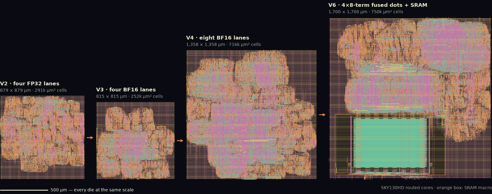
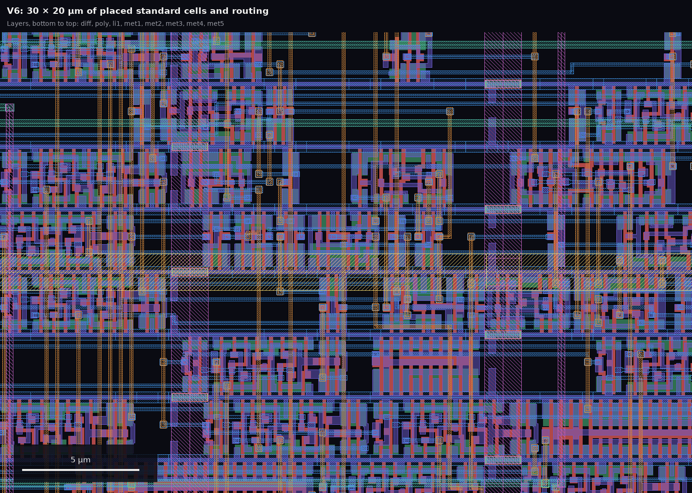
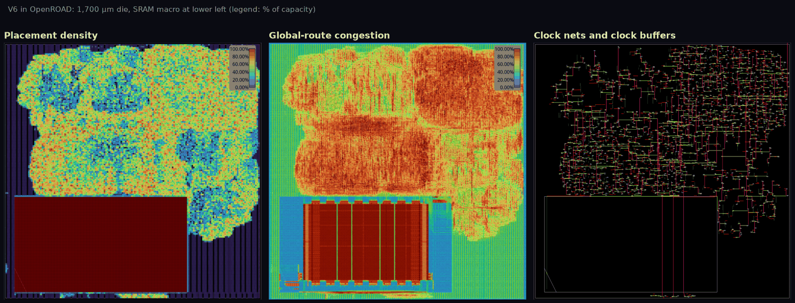
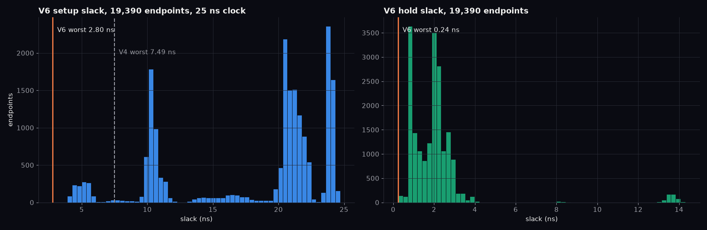
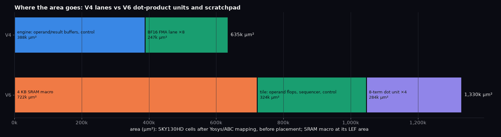

# Physical flow

The first target uses OpenROAD Flow Scripts through a pinned bazel-orfs checkout with the open SKY130HD platform. `make layout` builds `mac8_final` and converts it to GDS with real KLayout. The stages are synthesis, floorplan, placement, clock-tree synthesis, routing and final physical reports. See the [upstream flow tutorial](https://openroad-flow-scripts.readthedocs.io/en/latest/tutorials/FlowTutorial.html) for each stage.

Run from this repo:

```sh
make sim
make synth
make layout
klayout build/layout/mac8.gds
cd ~/.cache/openroad-chip-lab/bazel-orfs
bazelisk run //chip-lab:mac8_final open_final
```

`make layout` copies the GDS to `build/layout/mac8.gds`, the final timing report to `build/layout/timing.rpt`, and the router's DRC report to `build/layout/router_drc.rpt`. In the OpenROAD shell, use `report_checks -path_delay max` to examine a critical path. The tool checkout's `bazel-bin/chip-lab/` contains per-stage results and reports. Set `ORFS_TOOL_DIR` if the checkout lives elsewhere.

Verified 2026-09-12: the SKY130HD run used a 20 ns clock at the platform's typical 25 C, 1.8 V corner. Its final report showed 13.67 ns worst setup slack and 0.50 ns hold slack; detailed routing ended at zero router DRC errors and zero antenna violations. KLayout opened the 752,896-byte GDS as a 101.53 x 101.53 um `mac8` top cell. These are flow results under this lab's constraints, not independent signoff.

`bin/layout` rejects missing metrics, negative setup/hold slack, timing/electrical violations or a nonempty router DRC report. Antenna checks and foundry signoff remain separate.

`mac8_gds` explicitly selects a wrapper for the real KLayout executable; Bazel's strict action environment may omit `~/.local/bin` from `PATH`. The default bazel-orfs mock writes a dummy file, so keep this override in `tools/orfs/BUILD.bazel`.

The flow produces a core layout, not a complete chip. A fabrication package also needs a pad frame and ESD, power integration, foundry-specific DRC/LVS, timing and signal-integrity signoff, and acceptance by a fabrication service. The [open SKY130 PDK](https://skywater-pdk.readthedocs.io/en/main/) describes itself as an experimental preview suitable for test-chip work, not production signoff. Keep each gate distinct.

For an eventual shared-shuttle test chip, [Tiny Tapeout's local hardening guide](https://tinytapeout.com/guides/local-hardening/) is a possible route. Its template, pinout and acceptance checks are separate work; this lab core is not a submission package.

## Layouts



*V2 → V3 → V4 → V6, rendered from the routed GDS at one scale (met2–met5 shown). V6's orange box is its 722,109 µm² SRAM macro.*

| Tile | What changed | Die, µm | Standard cells, µm² | Reported fmax, MHz |
| --- | --- | ---: | ---: | ---: |
| V1 | One FP32 FMA per clock | 574.605 | 125,031 | 27.20 |
| V2 | Four FP32 lanes | 878.88 | 290,778 | 66.87 |
| V3 | Four lanes with BF16 operands, FP32 accumulation | 815.31 | 251,834 | 66.74 |
| V4 | Eight BF16 lanes, banked 8×8 operands | 1,358.125 | 716,253 | 57.12 |
| V5 | SRAM scratchpad and GEMM sequencer in front of V4 (retired, no GDS kept) | — | — | — |
| V6 | Four fused 8-term dot products behind the scratchpad | 1,700 | 749,555 | 45.04 |

Values come from each tile's `build/layout*/metrics.json`; fmax is the flow's timing estimate, not a retargeted build. V1 and V2 used different clock targets from V3 onward. Per-version renders: `docs/img/layout-{v1,v2,v3,v4,v6,mac8}.png`.



*A 30 × 20 µm window of V6, picked automatically as the densest logic: cell rows with diffusion, poly and li1, routed on met1–met3.*



*OpenROAD views of the final V6 database: placement density, global-route congestion (the GUI reruns global routing because the final database keeps no guides) and the clock nets with their buffers. The macro area reads as full because routing over it is blocked.*



*Setup and hold slack of all 19,390 V6 endpoints from OpenSTA on the final netlist and SPEF; worst setup +2.80 ns and hold +0.24 ns match the flow's metrics. V4's endpoint reports were not kept, so only its worst setup slack is marked.*



*Area by module after hierarchical Yosys/ABC mapping to SKY130HD (before placement, so below the routed totals). V6's SRAM macro is shown at its placed area.*

Regenerate the figures from the build outputs:

```sh
klayout -zz -r tools/render_layouts.py           # GDS renders
tools/physical_views.sh                          # OpenROAD views and endpoint slack (needs xvfb-run)
python3 tools/module_area.py <sky130_fd_sc_hd__tt_025C_1v80.lib>
uv run --with matplotlib --with pillow python tools/plot_figures.py
```
